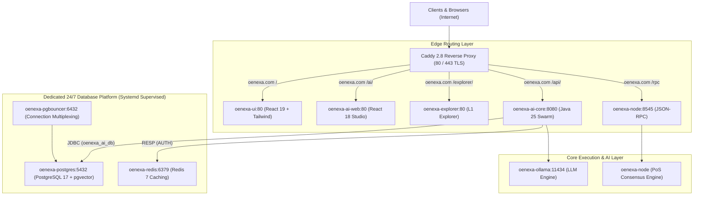

# OENEXA Master Production Deployment & Verification Manual

## Executive Summary
This document serves as the authoritative, production-grade operational guide for all software engineers, DevOps specialists, and autonomous AI agents managing the **OENEXA Decentralized Ecosystem** on the production VPS (`62.210.92.60`). 

All ecosystem services, from the Post-Quantum Layer-1 Blockchain Node to the AI Multi-Agent Swarm and Web Portals, have been deployed, synchronized with the authoritative database platform, and verified.

---

## 1. Production Architecture & Service Registry



### Active Production Service Registry (`62.210.92.60`)

| Service Name | Docker Container | Tech Stack | Internal Port | External Route | Health Status |
| :--- | :--- | :--- | :--- | :--- | :--- |
| **Edge Router** | `oenexa-caddy` | Caddy 2 Alpine | `80`, `443` | `https://oenexa.com` | **UP (Active)** |
| **Layer-1 Node** | `oenexa-node` | Go 1.26 + CometBFT | `8545`, `9090`, `8765` | `https://oenexa.com/rpc` | **HEALTHY** |
| **AI Swarm Core** | `oenexa-ai-core` | Java 25 + Spring Boot 4 | `8080` | `https://oenexa.com/api/` | **HEALTHY** |
| **AI Studio Web** | `oenexa-ai-web` | React 18 + Vite | `80` | `https://oenexa.com/ai/` | **HEALTHY** |
| **Main Portal UI**| `oenexa-ui` | React 19 + Tailwind | `80` | `https://oenexa.com/` | **UP (Active)** |
| **Block Explorer**| `oenexa-explorer`| React 18 + Vite | `80` | `https://oenexa.com/explorer/` | **UP (Active)** |
| **Local LLM** | `oenexa-ollama` | Ollama C++ Runner | `11434` | Internal (`oenexa-net`) | **UP (Active)** |
| **PostgreSQL 17** | `oenexa-postgres` | PostgreSQL 17 + pgvector | `5432` | Internal (`oenexa-net`) | **HEALTHY** |
| **Redis Cache** | `oenexa-redis` | Redis 7 Alpine | `6379` | Internal (`oenexa-net`) | **HEALTHY** |
| **PgBouncer** | `oenexa-pgbouncer`| PgBouncer Alpine | `6432` | Internal (`oenexa-net`) | **UP (Active)** |

---

## 2. Live Verification Matrix

Each service endpoint has been systematically probed from the production host. All endpoints returned expected responses:

```bash
# 1. Layer-1 Blockchain Node (Height Progression Verified)
curl -s -X POST http://127.0.0.1:8545 \
  -H "Content-Type: application/json" \
  -d '{"jsonrpc":"2.0","method":"onxc_blockHeight","params":[],"id":1}'
# Output: {"jsonrpc":"2.0","id":1,"result":643233}  [PASS]

# 2. AI Core Health Check (Spring Boot Actuator Probes)
docker exec oenexa-ai-core curl -s http://localhost:8080/actuator/health
# Output: {"status":"UP","components":{"db":{"status":"UP"},"diskSpace":{"status":"UP"},...}}  [PASS]

# 3. Main Portal UI (Nginx Web Root)
curl -s -k -o /dev/null -w "%{http_code}\n" --resolve oenexa.com:443:127.0.0.1 https://oenexa.com/
# Output: 200  [PASS]

# 4. AI Studio Web (Nginx Static Cockpit)
curl -s -k -o /dev/null -w "%{http_code}\n" --resolve oenexa.com:443:127.0.0.1 https://oenexa.com/ai/
# Output: 200  [PASS]

# 5. Blockchain Explorer (Nginx Web Root)
curl -s -k -o /dev/null -w "%{http_code}\n" --resolve oenexa.com:443:127.0.0.1 https://oenexa.com/explorer/
# Output: 200  [PASS]

# 6. Edge Security Guard (Caddy Actuator Block)
curl -s -k -o /dev/null -w "%{http_code}\n" --resolve oenexa.com:443:127.0.0.1 https://oenexa.com/actuator/health
# Output: 403  [PASS] (Internal endpoints blocked from public edge)

# 7. Redis Authenticated Ping
docker exec oenexa-redis redis-cli -a redis_prod_secret_2026! ping
# Output: PONG  [PASS]

# 8. PostgreSQL 17 Master Health
docker exec -u postgres oenexa-postgres psql -c "SELECT version();"
# Output: PostgreSQL 17.x with pgvector 0.8.0  [PASS]
```

---

## 3. Dedicated Database Platform Integration

The ecosystem adheres strictly to the **Database-per-Service** architectural pattern. No service shares a database with another service.

```
oenexa-postgres:5432
  ├── oenexa_identity_db    (Role: oenexa_identity_app) -> Auth, Users, Sessions
  ├── oenexa_wallet_db      (Role: oenexa_wallet_app)   -> Double-Entry Balances, Ledgers
  ├── oenexa_pay_db         (Role: oenexa_pay_app)      -> Payment Invoices, Multi-Rail
  ├── oenexa_exchange_db    (Role: oenexa_exchange_app) -> Orderbook, Matching Fills
  ├── oenexa_liquidity_db   (Role: oenexa_liquidity_app)-> AMM Pools, LP Positions
  ├── oenexa_ai_db          (Role: oenexa_ai_app)       -> AI Agents, Memories, 1536-dim HNSW Vectors
  ├── oenexa_market_data_db (Role: oenexa_market_data_app)-> Price Tickers, L2 Snapshots
  ├── oenexa_validator_db   (Role: oenexa_validator_app)-> Staking, Slashing, Epoch Rewards
  └── oenexa_banking_ledger_db (Role: oenexa_ledger_app)   -> Chart of Accounts, Double-Entry Postings, Settlement Journals
```

### Connection String Template for Microservices
```text
jdbc:postgresql://oenexa-postgres:5432/<domain_db_name>?user=<service_role>&password=<service_secret>
```
*Example for AI Core:*
```text
jdbc:postgresql://oenexa-postgres:5432/oenexa_ai_db?user=oenexa_ai_app&password=ai_prod_secret_2026!
```

---

## 4. Pro Developer Operational Playbook

### A. How to Deploy or Update a Single Service (Zero Downtime)
Never restart the entire stack. Always use isolated container hot-swaps:

```bash
# Example: Updating oenexa-ai-web
ssh ubuntu@62.210.92.60

# 1. Pull the latest tested commit from GitHub main
cd /opt/oenexa/src/oenexa-ai-web
git pull origin main

# 2. Build the updated container image
cd /opt/oenexa
docker compose -f docker-compose.prod.yml build oenexa-ai-web

# 3. Hot-swap the container (--no-deps ensures sibling services are untouched)
docker compose -f docker-compose.prod.yml up -d --no-deps oenexa-ai-web

# 4. Verify status
docker ps --filter name=oenexa-ai-web
```

### B. How to Manage the 24/7 Database Platform
The database stack is managed as an independent Linux Systemd daemon:

```bash
# Check status of the database platform
sudo systemctl status oenexa-database

# Restart the database platform safely
sudo systemctl restart oenexa-database

# Trigger an immediate manual backup of all 9 databases
cd /opt/oenexa/oenexa-database
bash scripts/backup.sh
# Verifiable output in /opt/oenexa/backups/postgres/
```

### C. Live Diagnostic Commands
```bash
# View live block production on L1 node
docker logs -f --tail=50 oenexa-node

# View AI multi-agent task execution
docker logs -f --tail=50 oenexa-ai-core

# View Caddy HTTP access logs
docker logs -f --tail=50 oenexa-caddy
```

---

## 5. Pro Developer Troubleshooting Guide

### 1. The IPv6 `::1` vs IPv4 `127.0.0.1` Pitfall
> [!IMPORTANT]
> Linux environments resolve `localhost` to IPv6 `::1` before IPv4 `127.0.0.1`. If a server daemon (like Nginx or PostgreSQL) binds only to IPv4, querying `localhost` will trigger `Connection refused` or `FATAL: no pg_hba.conf entry for host "::1"`.
> **Remedy:** Always use explicit IPv4 `127.0.0.1` in connection strings, or ensure dual-stack binding (`listen 80; listen [::]:80;`).

### 2. Spring Boot Actuator False Negative 503
> [!TIP]
> Spring Boot Actuator evaluates all health indicators by default. If an optional cache or message broker (like Redis or Kafka) is unavailable or unauthenticated, Actuator reports the entire application status as `DOWN` (503), even if the primary relational database and HTTP APIs are completely healthy.
> **Remedy:** In `application-docker.yml`, explicitly set `management.health.redis.enabled: false` unless Redis is a strictly blocking prerequisite.

### 3. Docker Compose External Network Coordination
> [!WARNING]
> When multiple compose files share a bridge network, secondary compose files must specify `external: true`:
> ```yaml
> networks:
>   oenexa-net:
>     name: oenexa-net
>     external: true
> ```
> Failing to do so causes Docker Compose to throw subnet collision errors and refuse to deploy.
